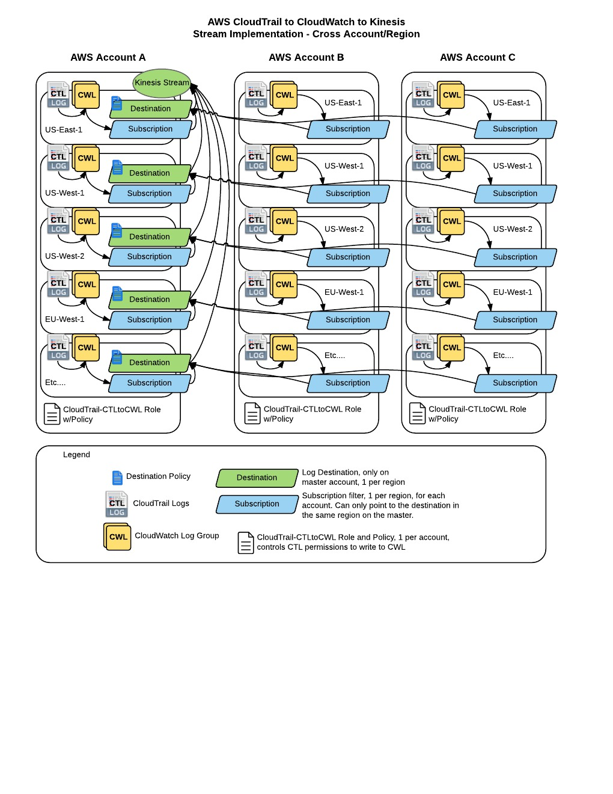

# cross-account-cloudwatch-logs-to-kinesis

> **⚠️ Archived / Deprecated**
>
> This repository documents a pattern from 2015–2018 and is no longer maintained.
> The downstream consumer it relied on
> ([`awslabs/cloudwatch-logs-subscription-consumer`](https://github.com/awslabs/cloudwatch-logs-subscription-consumer))
> is itself unmaintained, and AWS now offers simpler, first-party alternatives
> for the cross-account CloudTrail → logging pipeline.
>
> **Consider these modern replacements instead:**
> - **AWS Organizations CloudTrail** — a single organization trail that captures events from all accounts, delivered to a central S3 bucket.
> - **CloudWatch cross-account observability** — share logs/metrics/traces across accounts without a custom pipeline.
> - **Amazon Data Firehose → OpenSearch Service** — managed delivery from CloudWatch Logs subscriptions to OpenSearch, replacing the old Kinesis + custom consumer + ELK setup.
> - **CloudTrail Lake** — managed, queryable CloudTrail event store if search is the main goal.
>
> The original content is preserved below for historical reference.

---

This project is provide documentation on how to setup Amazon AWS CloudTrail to CloudWatch logs across multiple accounts and send them all to a single Kinesis stream. The end goal is to have those logs picked up by https://github.com/awslabs/cloudwatch-logs-subscription-consumer to be processed in ELK.

